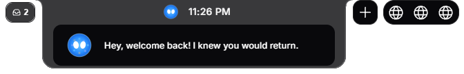
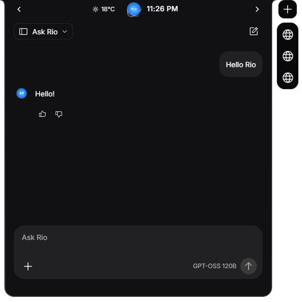
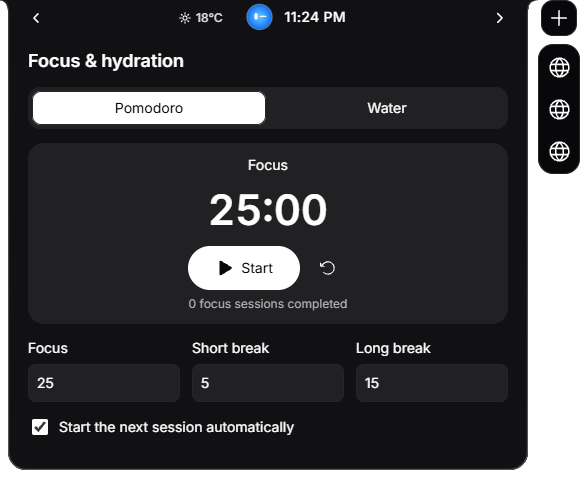
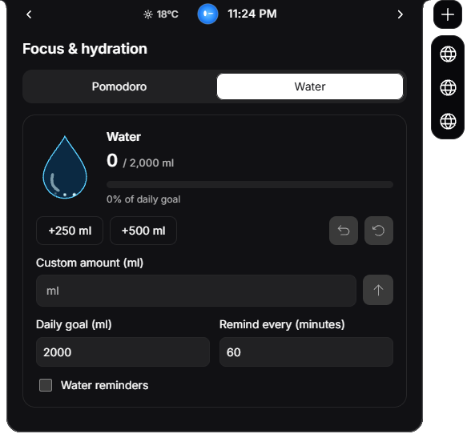
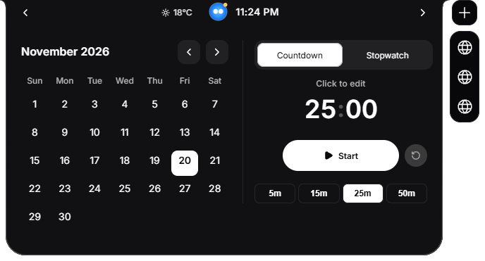

  

<h1 align="center">Rio</h1>

<strong>Always Yours.</strong>

**A little space at the top of your screen. Plenty to discover inside.**

Rio is a small, interactive notch for your Windows desktop. It brings your music, files, timers, tasks, quick controls, and AI conversations into one place you can reach whenever you need it.

Click the notch and have a look around. Change the song. Start a focus session. Grab that file you saved earlier. Ask a quick question.

There's also a little blue mascot that gets rather interested in what you're doing.

**[Download Rio for Windows](https://github.com/StormSplits/Rio---Always-Yours/releases/latest)** · [See the latest updates](https://github.com/StormSplits/Rio---Always-Yours/releases) · [Report a bug](https://github.com/StormSplits/Rio---Always-Yours/issues/new)

**Windows only. Currently available as a 64-bit installer.**

  

Your little desk companion is happy you're back.

## Meet your notch

Rio floats at the top center of your chosen display without reserving a strip of desktop space.

Keep it visible, let it peek out when needed, or choose a smarter hiding behavior. It is designed to step aside for fullscreen games and videos.

Use a laptop, a desktop, or several displays? Choose where Rio lives and adjust its appearance, scale, and behavior to suit your setup.

## A peek inside

<table>
  <tr>
    <td width="50%" valign="top" align="center">
      <h3>Ask Rio</h3>
      
      
A quick question. A little blue company.

    </td>
    <td width="50%" valign="top" align="center">
      <h3>Find your focus</h3>
      
      
One focus session at a time.

    </td>
  </tr>
  <tr>
    <td width="50%" valign="top" align="center">
      <h3>A little water break</h3>
      
      
A tiny nudge to take care of yourself.

    </td>
    <td width="50%" valign="top" align="center">
      <h3>Make room for your day</h3>
      
      
A home for the things you don't want to forget.

    </td>
  </tr>
</table>

Dark-theme previews from Rio 0.1.6. Conversation and calendar examples are sample data.

## What's inside

| Feature | What you can do |
| --- | --- |
| **Music and lyrics** | See album artwork, control playback, seek through a track, and watch a music-reactive visualizer. Follow synchronized lyrics where available, including a compact lyric line in the notch. |
| **Ask Rio** | Have quick AI conversations using your own Groq API key. Get streamed answers, automatic web search when needed, readable Markdown, code blocks, tables, and maths. |
| **Recent chats** | Revisit conversations, rename them, or start fresh. Attach supported text files when a question needs more context. |
| **File Shelf** | Drop files and text into a handy place for later. Preview supported items, open them, copy them, or drag files back out. Shelf entries stay across restarts. |
| **App and website shortcuts** | Keep frequently used apps and websites beside the notch. Add shortcuts, change their names or destinations, and remove them when you're finished. |
| **Countdown and stopwatch** | Set a countdown or track elapsed time with laps. Use compact controls for pausing, resuming, and resetting. |
| **Multiple timed activities** | Run a countdown, stopwatch, and Pomodoro together. Separate activity cards keep their controls within reach, with an option to collapse the group. |
| **Pomodoro** | Set your focus, short-break, and long-break durations. Let the next session start automatically if that suits your rhythm. |
| **Hydration** | Set a daily water goal, log preset or custom amounts, undo an entry, and schedule water reminders. |
| **Tasks** | Add and edit to-dos, set due dates and repeat reminders, check things off, and manage several tasks together. |
| **Calendar and reminders** | Browse dates, see reminder dots, and open a date's details. Create one-time, daily, weekly, or yearly reminders with a custom date and time picker. |
| **Clipboard history** | Bring Windows clipboard history into the notch, including text and screenshots. Copy entries, remove individual items, or clear the history. |
| **Screen Markup** | Draw on your screen with a pencil, highlighter, and eraser. Choose colors, move the toolbar, undo or redo strokes, then copy the result or save a PNG wherever you choose. |
| **QR codes** | Turn text or a link into a QR code. Preview it, copy the image, or save a named PNG to your preferred folder. |
| **Quick controls** | Reach Wi-Fi, Bluetooth, volume, and supported laptop brightness controls from Command Center. |
| **Connected devices** | Check connected devices and see battery information when the device reports it. |
| **Battery feedback** | See battery and charging information on supported systems, with a configurable low-battery alert. |
| **On-screen feedback** | Get brief volume, supported brightness, and Caps Lock updates through the notch. |
| **Weather** | Follow your approximate current location or search for a city manually. Search results include the region and country to help you choose the right place. |
| **System stats** | Choose status widgets for CPU, memory, disk space, and network activity. Arrange what appears beside the clock. |
| **Notification previews** | Preview visible Windows notification banners. Choose whether message content appears, and use Rio's own Do Not Disturb mode when you want quiet. |
| **Coding-agent activity** | Follow supported status events from Claude Code, Codex, and OpenCode after connecting them. See when an agent is working, finishes, or needs your attention. |
| **A reactive mascot** | Watch Rio react to typing, music, completed tasks, and other interactions. Optional idle check-ins and welcome-back reactions add a little company to your desktop. |
| **Your own look** | Choose dark, light, custom-color, or adaptive-accent themes. Adjust transparency, interface scale, display selection, and mascot interactions. |

A few features depend on your setup. Hardware controls appear only where supported, and lyrics depend on availability for the track. Notification previews mirror visible Windows banners, so banners suppressed by Windows Do Not Disturb cannot be shown through this feature.

Keep Rio running in the system tray for reminders to trigger.

## Quick chats with Ask Rio

Sometimes you just need an explanation, a second opinion, or a quick answer while you're working.

Add your Groq API key in **Settings > Privacy & AI**, then open **Ask Rio** from Command Center.

Rio currently uses **GPT-OSS 120B through Groq**. When a question needs current information, it can use Groq's [web search and browsing capability](https://console.groq.com/docs/tool-use/built-in-tools/browser-search) automatically.

Your recent conversations are saved locally, so you can return to them later.

Groq is an online service. Its usage limits and any charges depend on your Groq account.

## Your data and privacy

Your saved chats, tasks, reminders, Shelf entries, preferences, and API key are stored on your PC. Sensitive saved records are encrypted using protection tied to your Windows account.

Online features still need online requests:

- **Ask Rio** sends your question, relevant conversation context, and any attachment text included in the request to Groq.
- **Weather** contacts location and weather providers. Automatic location uses an IP-based lookup; you can choose a city manually.
- **Lyrics and website icons** contact their respective services.
- **Update checks** contact Rio's GitHub release repository.

Windows manages your clipboard history. Screen Markup and QR exports are saved to the location you choose.

## Getting started

1. Download the latest Windows installer from the [official releases page](https://github.com/StormSplits/Rio---Always-Yours/releases/latest).
2. Install Rio in your preferred folder.
3. Open the notch and explore Command Center.
4. Visit Settings to choose your display, theme, widgets, and behavior.
5. Add a Groq API key if you want to use Ask Rio.

Clipboard history must be enabled in Windows and switched on in Rio's Notch settings to appear in the notch.

For future updates, open **Settings > About > Check for Updates**. Updates are designed to preserve your existing Rio settings and saved data.

## A note about Windows security warnings

Rio's installer does not yet have a Windows publisher signature. Microsoft Defender SmartScreen may show an unrecognized-app or unknown-publisher warning while Rio is new and unsigned. [Microsoft explains how these reputation checks work here.](https://learn.microsoft.com/en-us/windows/apps/package-and-deploy/smartscreen-reputation)

Please download Rio through the official releases linked above and keep your Windows security protection enabled. If your antivirus reports a specific threat, share the exact detection so it can be investigated.

Rio's in-app updater uses a separate cryptographic signature to verify update installers.

## Help Rio grow

Rio is still early. You may find bugs, visual glitches, or something that behaves differently on your PC.

If you do, please [report it here](https://github.com/StormSplits/Rio---Always-Yours/issues/new). I'd really appreciate it. Those reports help me find the rough edges, fix them, and make the next update better.

A useful report includes:

- Your Rio version and Windows version.
- What you were doing when the problem happened.
- What you expected and what happened instead.
- A screenshot or short recording, if it helps.

Please hide personal information before sharing screenshots, and never include API keys.

Suggestions are welcome too. If there's a small everyday annoyance you wish the notch could handle, tell me about it.

Thanks for giving Rio a little place on your desktop.

**Made by Shubham Singhania · [StormSplits](https://github.com/StormSplits)**
